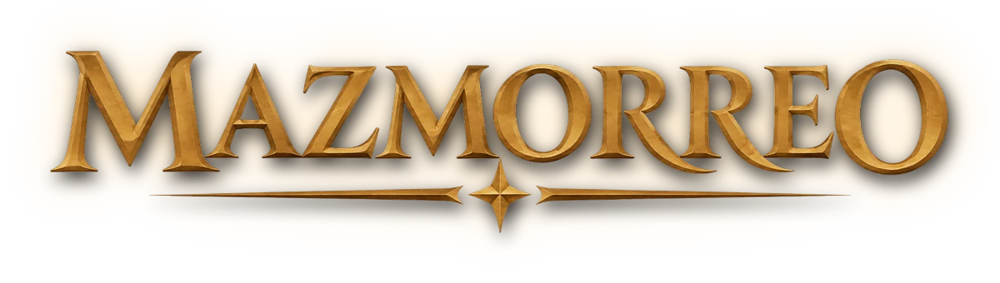
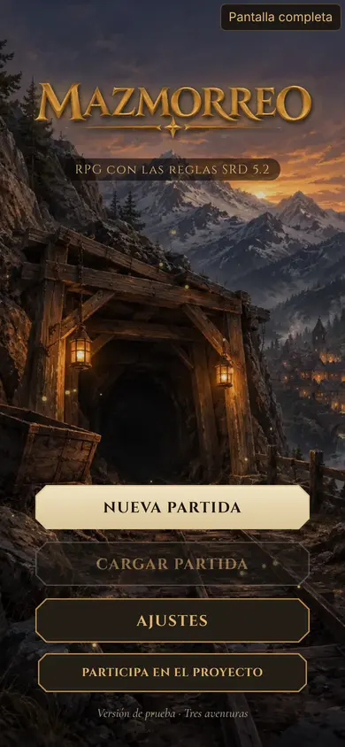
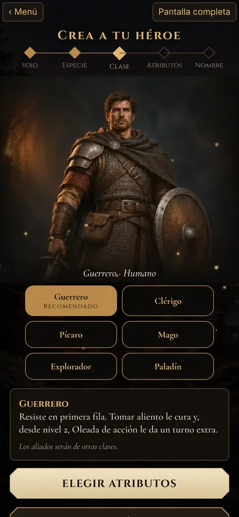
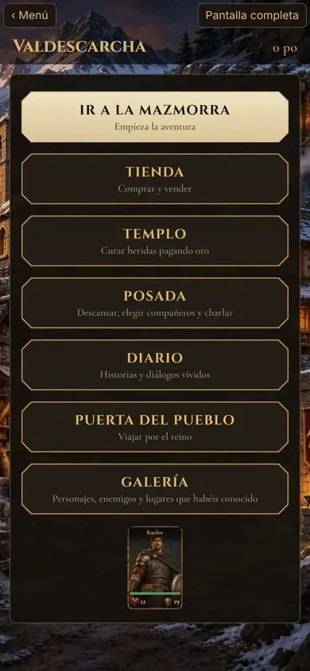
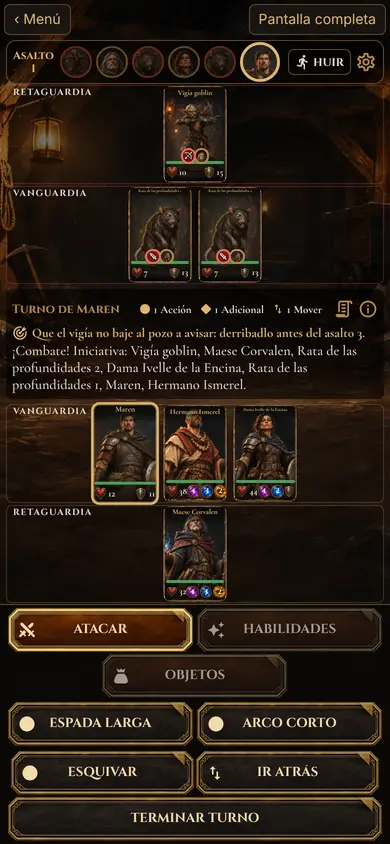

<p align="center"></p>

<p align="center">
  <a href="https://churrufli.github.io/mazmorreo-rpg/"><b>Jugar en el navegador</b></a> ·
  <a href="../../releases">Descargar APK</a> ·
  <a href="CONTRIBUTING.md"><b>Participa en el proyecto</b></a>
</p>

<p align="center">
  <a href="https://discord.gg/VvKXn7ZMEG"></a>
</p>

<p align="center"><b>Proyecto abierto: colabora en código, narrativa, arte, mapas o combate, también con tu IA.</b></p>

<p align="center">
  
  
  
  
</p>

# Mazmorreo

**RPG de fantasía medieval para Android**, pensado para jugar con el móvil en vertical y diseñado para jugar en solitario, sin director de juego. Crea un héroe, explora mazmorras y territorios mediante mapas de casillas hexagonales, toma decisiones con consecuencias y combate por turnos junto a los aliados que elijas.

El sistema parte de las reglas de quinta edición del **SRD 5.2.1** (2024), adaptadas a una experiencia táctil y a grupos de uno a cuatro personajes. Es un proyecto independiente, en desarrollo, y los APK publicados son **versiones de prueba**. La versión web es para probarlo en el navegador; la experiencia de referencia es Android con el móvil en vertical (el modo horizontal queda para más adelante).

## Las tres aventuras

| Orden | Aventura | Punto de partida | Ambientación y conflicto | Progresión al completarla |
| --- | --- | --- | --- | --- |
| 1 | **Las profundidades de Hondaroca** | **Valdescarcha** | Minas abandonadas, ruinas enanas, cripta real y monasterio hundido. El mago **Maese Orvane** amenaza las profundidades. | El grupo alcanza al menos el **nivel 3**. |
| 2 | **El Corazón Hueco** | **Vegaumbría** | El **Bosque de Umbría** se ha vuelto hostil. Desapariciones, una ciénaga y secretos antiguos conducen hasta el propio Corazón del bosque. | El grupo alcanza al menos el **nivel 5**. |
| 3 | **El Invierno del Dragón** | **Cumbrenieve** | Un paso nevado, bosques helados y una fortaleza enana conducen al dragón blanco **Vharzûl**. | El grupo alcanza al menos el **nivel 6**. |

Las aventuras se desbloquean **en orden**. Cada una tiene **cuatro zonas**, salas, encuentros, personajes, decisiones y recompensas propias. Existen secretos relacionados entre aventuras que pueden animar a regresar a zonas anteriores.

## Cómo se juega

- **Héroe y aliados:** crea tu personaje, escoge especie y clase y forma un grupo de hasta **cuatro** (tu héroe y tres aliados). Los aliados conocidos pueden cambiarse en la **posada**; no es obligatorio llevar siempre a los mismos.
- **Exploración hexagonal:** descubre zonas con niebla de guerra, muévete tocando el mapa, investiga secretos y vuelve a lugares anteriores. Hay encuentros al explorar y al regresar a determinadas zonas.
- **Combate táctico por turnos:** iniciativa, tiradas de d20, ataques, conjuros, habilidades, estados y dos filas de combate (**vanguardia y retaguardia**). Algunas batallas incluyen objetivos opcionales.
- **Escenas con decisiones:** puedes negociar, ayudar, arriesgarte, investigar o evitar enfrentamientos. Las elecciones pueden alterar oro, objetos, pistas, secretos y composición de encuentros.
- **Progresión y recursos:** equipo, armas, pociones, botín, descansos cortos y largos, templo, tiendas y un baúl compartido entre posadas.
- **Relaciones con compañeros:** conversaciones desbloqueables en la posada y **afinidad**; al completar su tercera charla, un aliado obtiene **Inspiración heroica**.
- **Diario y galería:** registro de acontecimientos, pistas pendientes e ilustraciones de personajes, lugares y escenas.

## Equilibrio y dificultad

El juego **mantiene como referencia el SRD 5.2.1**, pero ajusta la composición de los encuentros a un videojuego individual:

- Los combates normales usan presupuestos moderados para la progresión del jugador y límites de enemigos según el tamaño del grupo: **1 / 2 / 3 / 4** enemigos para grupos de **1 / 2 / 3 / 4** personajes, respectivamente, en el ajuste ordinario. Las **decisiones con refuerzos** pueden modificar esos límites.
- Los jefes finales son **únicos**: el escalado no puede generar copias de Orvane, el Corazón o Vharzûl.
- Los refuerzos se asignan a criaturas acompañantes elegibles, respetando las **dos filas** y un máximo de **tres enemigos por fila**.
- En el comienzo de Hondaroca, cuando el héroe está solo, se limita el número de enemigos y los goblins guerreros se sustituyen por esbirros.
- Un encuentro especialmente peligroso con un **montículo andante** en la ciénaga se ha hecho **evitable**, con aviso narrativo.
- Tras una derrota se regresa al último guardado con una penalización del **10 % del oro**.
- Los jefes conceden su recompensa de experiencia completa incluso cuando se reduce el número de acompañantes.

Estos ajustes **no garantizan** que todas las clases o composiciones tengan la misma dificultad. Hay pruebas automáticas y un estudio de jugabilidad con bot, pero los resultados de simulaciones simplificadas no deben interpretarse como partidas completas del motor.

## Narrativa y representación del mapa

Las escenas se escriben para funcionar **independientemente del decorado gráfico del mapa**. No deben afirmar que existe una escalera, saco, pared, puerta, pasadizo u otro elemento físico visible si no está garantizado en la representación. Los objetos que forman parte de una **escena interactiva** pueden mencionarse dentro de esa escena, sin prometer que aparecen dibujados en la casilla.

La revisión narrativa de las tres aventuras incluye introducciones de escenas, diálogos y consecuencias de decisiones. El motor usa el aviso neutro **«Habéis descubierto un secreto»**, sin mensajes como «ya lo veis en el mapa». Los secretos y sus efectos siguen funcionando.

## Versión para navegador

La adaptación web reutiliza el juego con React Native Web. Incluye guardado local, ilustraciones, fuentes y audio. Se puede jugar en **[churrufli.github.io/mazmorreo-rpg](https://churrufli.github.io/mazmorreo-rpg/)**; las partidas se guardan en tu navegador, sin cuentas ni registro. Consulta [la guía web](docs/WEB.md) para ejecución, pruebas y publicación.

## Descargar e instalar en Android

1. Abre **[Releases](../../releases)** y descarga el último archivo `mazmorreo-N.apk`.
2. Instálalo en tu móvil Android; si el sistema lo solicita, autoriza la instalación desde esa fuente.
3. **Si tenías una APK anterior a la v0.143, desinstálala primero**: desde esa versión las APK se firman con otra clave y no se instalan encima de las antiguas. Las partidas de la versión anterior se pierden.
4. Las versiones de prueba están pensadas para actualizar la aplicación existente. **Haz una copia de seguridad de tus datos si son importantes**: la conservación de partidas puede depender de la firma y la compatibilidad entre versiones.

> **Versión:** el workflow de GitHub Actions genera la etiqueta `v0.N` y el archivo `mazmorreo-N.apk`, donde `N` es el número de ejecución de ese workflow. El `version` de `package.json` no identifica por sí solo el APK publicado.

## Desarrollo

**Tecnologías:** React Native **0.81.6** (CLI, sin Expo), React **19**, TypeScript, Zustand, MMKV, SVG y Android/Gradle. La compilación de CI usa **Node.js 22** y **JDK 17**.

```bash
npm ci
npm test
npx tsc --noEmit
npm run validate:adventures
```

Para ejecutar en Android con un entorno React Native configurado:

```bash
npm run android
```

### Compilación del APK

La compilación de publicación se inicia **manualmente** en **[Actions → Android APK](../../actions/workflows/android.yml)** mediante **Run workflow**, sobre la rama deseada (normalmente `master`). El flujo instala dependencias, comprueba TypeScript y Jest, genera un APK `assembleRelease`, lo adjunta como artefacto y publica una **pre-release** en GitHub Releases.

**No** se ejecuta automáticamente en cada push. Una PR fusionada **no implica** que exista un APK nuevo.

### Pruebas y estudio de jugabilidad

```bash
npm test
npm run validate:adventures
EQUILIBRIO=1 npx jest equilibrio --runInBand
ESTUDIO=1 N=20 npx jest estudio --runInBand
```

En PowerShell, establece las variables con `$env:ESTUDIO="1"; $env:N="20"` antes del comando Jest. El estudio con bot es **informativo**, no una prueba concluyente de equilibrio, y no sustituye las pruebas en dispositivos reales.

### Archivos principales

| Ruta | Contenido |
| --- | --- |
| `src/data/hondaroca.json` | Historia, salas, encuentros y decisiones de Hondaroca. |
| `src/data/corazon.json` | Contenido de El Corazón Hueco. |
| `src/data/montana.json` | Contenido de El Invierno del Dragón. |
| `src/data/charlas.json` | Conversaciones de afinidad de los aliados. |
| `src/engine/aventuras.ts` | Registro de aventuras, pueblos, jefes, aliados y progresión. |
| `src/engine/escenas.ts` | Resolución de decisiones, secretos y ajuste de enemigos. |
| `src/engine/combat.ts` | Combate por turnos y recompensas. |
| `src/data/ayuda.ts` | Ayuda integrada y novedades del juego. |
| `src/engine/*.test.ts` | Pruebas de reglas, escenas, economía, equilibrio y partidas. |
| `scripts/validar-aventuras.mjs` | Validación de datos de aventuras. |
| `scripts/generar-plano.mjs` | Generación del plano hexagonal. |
| `scripts/convertir-arte.sh` | Conversión del arte a WebP y generación de referencias. |
| `.github/workflows/android.yml` | Compilación manual del APK y publicación de pruebas. |

## Documentación adicional

- [Historial de cambios destacados](CHANGELOG.md).
- [Guía de mantenimiento de contenido, narrativa y equilibrio](docs/GUIA_CONTENIDOS.md).

## Estado del proyecto

**En desarrollo activo.** Las tres aventuras están integradas en el repositorio y se han revisado la narrativa, el equilibrio de encuentros, la gestión de aliados y la documentación del juego. Sigue siendo necesario **verificar las compilaciones, ejecutar las pruebas y comprobar la dificultad en partidas reales** tras los cambios.

Repositorio: [github.com/churrufli/mazmorreo-rpg](https://github.com/churrufli/mazmorreo-rpg).

## Colaborar

**¡Participa!** Se buscan colaboraciones en código, narrativa, arte, mapas, combate, sonido y equilibrio, a mano o con tu IA. Este juego se ha hecho así: una persona decide y una IA lo programa, lo escribe o lo dibuja siguiendo las reglas del repositorio.

1. Lee [CONTRIBUTING.md](CONTRIBUTING.md).
2. Conecta tu IA con la guía [Colaborar con tu IA](docs/COLABORAR_CON_IA.md), que trae plantillas por área para Claude Code, Codex, Copilot, Cursor, Gemini o ChatGPT.
3. Elige un issue con la etiqueta `buena primera tarea` y abre una PR.

## Licencias

- **Código:** MIT ([LICENSE](LICENSE)).
- **Arte y textos:** CC BY-NC-SA 4.0 ([LICENSE-CONTENIDO.md](LICENSE-CONTENIDO.md)).
- **Reglas:** SRD 5.2.1 de Wizards of the Coast, CC BY 4.0 ([NOTICE.md](NOTICE.md)).
- **Tipografías, iconos, música y sonido:** ver [CREDITS.md](CREDITS.md). Todo el audio es CC0 o CC BY.

Las ilustraciones se generaron con IA (ChatGPT) y se revisaron a mano. Mazmorreo es un proyecto independiente, sin relación con Wizards of the Coast.
