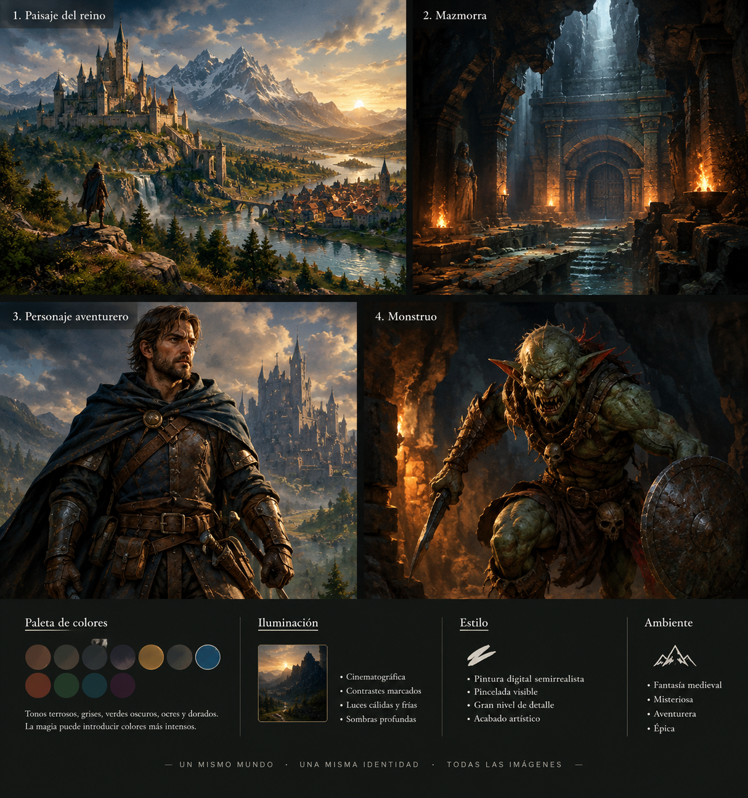

# Guía de arte

Cómo generar ilustraciones nuevas para Mazmorreo sin que desentonen con las que ya tiene el juego. Todo el arte actual se hizo con ChatGPT siguiendo estas reglas, y luego se revisó, corrigió y recortó a mano.

## La imagen maestra



[`docs/arte/referencia-maestra.png`](arte/referencia-maestra.png) es la referencia de estilo de todo el juego: paisaje, mazmorra, aventurero y monstruo en una misma lámina. **Adjúntala siempre** al generador junto con el prompt. Debe seguir su estilo, pero no copiar sus personajes ni sus escenarios.

| Paleta | Iluminación | Estilo | Ambiente |
| --- | --- | --- | --- |
| Tonos terrosos, grises, verdes oscuros, ocres y dorados. La magia puede introducir colores más intensos. | Cinematográfica, contrastes marcados, luces cálidas y frías, sombras profundas. | Pintura digital semirrealista, pincelada visible, gran nivel de detalle, acabado artístico. | Fantasía medieval, misteriosa, aventurera y épica. |

Si además tienes una imagen ya aprobada del mismo tipo (por ejemplo, `assets/img/goblin_espada.webp` para una carta de enemigo), adjúntala también y di que copie **solo el encuadre**, no el fondo ni el personaje.

## Cómo trabajar con el generador

1. Abre un **chat nuevo por lote** de 5 imágenes como mucho: tras muchas imágenes en el mismo chat el estilo deriva.
2. Adjunta la imagen maestra (y la de encuadre, si la hay).
3. Pega el bloque de lote de abajo con las reglas del tipo de imagen y tus prompts numerados.
4. Escribe «siguiente» para pasar a la siguiente imagen. Si una sale mal, repite su código y di qué corregir.

```text
Te paso un lote de [N] prompts numerados para un RPG de fantasía medieval. Adjunto la imagen maestra de estilo [y una imagen aprobada que marca el encuadre].

FORMA DE TRABAJAR:
- Genera SOLO la imagen del primer prompt y espera.
- Cada vez que yo escriba "siguiente", genera la imagen del siguiente prompt de la lista.
- Una sola imagen por respuesta. Antes de la imagen escribe únicamente su código, sin más comentarios.
- Genera EXACTAMENTE lo que describe cada prompt. No inventes otros personajes, criaturas ni escenas, y no repitas una imagen anterior.
- Aplica SIEMPRE las reglas comunes a cada prompt, sin cambiar ni omitir nada. Si vuelvo a escribir el código de un prompt, repite esa imagen corrigiendo lo que te diga.
- Mantén el mismo estilo e iluminación en todas las imágenes del lote: deben verse como una serie.

REGLAS COMUNES A TODOS LOS PROMPTS DEL LOTE:
[reglas del tipo de imagen, de la sección siguiente]

ESTILO ARTÍSTICO (obligatorio): pintura digital semirrealista de fantasía medieval épica. Iluminación cinematográfica con luces cálidas y sombras frías, contrastes marcados, sombras profundas y profundidad atmosférica. Pincelada visible con un acabado detallado y cuidado. Paleta terrosa de marrones, grises, verdes oscuros, ocres y dorados apagados; los colores mágicos intensos, solo en elementos especiales o mágicos. Aspecto adulto, elegante y coherente; ambiente misterioso, aventurero y épico.
EVITAR: estética infantil, caricaturesca, anime o chibi, aspecto fotográfico o fotorrealista, aspecto de render 3D y exceso de ornamentos. Sombrío, pero sin vísceras ni sangre abundante.
REFERENCIA: la imagen maestra adjunta establece el estilo obligatorio (iluminación, tratamiento pictórico, paleta, nivel de detalle y atmósfera). Síguela de cerca, pero no copies sus personajes ni sus escenarios.
NUNCA incluyas textos, letras, números, logotipos, firmas, marcas de agua, marcos ni interfaz.

PROMPTS:
[A1] ...
[A2] ...
```

En cada prompt describe **una sola cosa** con detalle: complexión, ropa, colores, pose, expresión y el rasgo que la distingue de otras parecidas (por ejemplo, «más grande y más blanco que un lobo corriente»). Da a cada personaje ropa, color y pose propios para que no salgan todos iguales.

## Reglas por tipo de imagen

Copia en el bloque de lote las reglas del tipo que vayas a generar.

### Cartas de héroes, aliados y enemigos

```text
Ilustración de la carta de un personaje o criatura, con personalidad propia y silueta reconocible incluso en tamaño pequeño.
FORMATO: vertical 2:3 (1024x1536). El marco y los textos los añade la aplicación, que además recorta una ficha redonda de la zona de la cabeza.
ENCUADRE: la figura está centrada y se ve entera, ocupa entre el 80 y el 85% de la altura, con la cabeza en el tercio superior, bien visible e iluminada, y nada importante pegado a los bordes.
FONDO (muy importante, la carta se usará en muchos lugares): oscuro y neutro, penumbra con una ligera niebla y un suave resplandor cálido en una esquina superior, sin que se vea de dónde viene, y el suelo apenas insinuado. Ningún lugar reconocible: ni rocas, ni árboles, ni muros, ni arcos, ni antorchas, ni edificios.
```

### Fondos de ambiente e introducción

```text
FORMATO: vertical 9:16 (pantalla de móvil). Si no puedes, vertical 2:3 (1024x1536) con todo lo importante dentro del 85% central del ancho, porque los lados se recortarán.
Sin personajes ni monstruos. La luz procede solo de fuentes justificadas (cielo, luna, hogueras, faroles, cristales mágicos).
Ilustración que se muestra al entrar en una zona: perspectiva cinematográfica con mucha profundidad que lleve la mirada hacia el fondo. Deja el tercio inferior más oscuro y tranquilo, porque ahí irá un cuadro de texto.
```

### Fondos de combate

```text
FORMATO: vertical 9:16 (o 2:3 con lo importante en el 85% central del ancho).
Fondo de la pantalla de combate: las cartas (enemigos arriba, grupo del jugador abajo) y los botones taparán casi todo, así que debe quedarse discretamente detrás.
COMPOSICIÓN: vista cercana y baja del suelo de este lugar. Muy poco detalle y poco contraste en el centro; el interés y las luces, solo cerca de los bordes izquierdo y derecho. En el centro, una franja horizontal algo más iluminada, hecha SOLO con luz natural del lugar, que separe la mitad superior de la inferior. Más oscuro hacia arriba y abajo.
PROHIBIDO dibujar rectángulos, paneles, recuadros, velos grises, marcos o formas geométricas de interfaz: la imagen es una escena continua. Sin criaturas ni objetos protagonistas en el centro.
```

### Suelos, paredes y agua del mapa

```text
FORMATO: cuadrado 1:1 (1024x1024). Vista cenital estricta, cámara perpendicular al suelo, sin perspectiva ni ángulo isométrico.
La textura llena todo el cuadrado de forma uniforme y se repite sin costuras: el borde izquierdo encaja con el derecho y el superior con el inferior, sin elementos cortados ni cambios de brillo en los bordes. Iluminación uniforme y suave, sin sombras direccionales ni viñeteado.
La aplicación la recorta en hexágonos: NO dibujes hexágonos, cuadrícula ni bordes. Sin objetos sueltos, personajes ni símbolos.
```

### Objetos del mapa (árboles, rocas, cofres, altares…)

```text
FORMATO: cuadrado 1:1 (1024x1024). Vista cenital o de tres cuartos desde arriba. Un único objeto centrado que ocupe alrededor del 75% del lienzo, con silueta clara, legible a unos 96x96 px y fácil de distinguir sobre cualquier suelo. Luz suave desde arriba a la izquierda y, como mucho, una pequeña sombra de contacto.
FONDO: blanco puro (#FFFFFF), liso, sin degradado ni textura. NO intentes hacer transparencia (nada de damero gris y blanco): el recorte lo hacemos nosotros. Sin casillas, cuadrícula, personajes ni textos.
```

### Objetos de inventario

```text
REUTILIZABLE: diseño genérico, sin emblemas, símbolos religiosos, escudos ni motivos de un lugar concreto, y sin tonos violeta salvo que el objeto sea mágico.
FORMATO: cuadrado 1:1 (1024x1024). Un único objeto centrado y completo que ocupe alrededor del 70% del lienzo, en vista clara de tres cuartos. Debe leerse bien a unos 64x64 px: silueta marcada y buen contraste. Los objetos mágicos llevan un brillo SUTIL, nunca exagerado.
FONDO: blanco puro (#FFFFFF), liso, sin sombra, degradado ni textura. NO intentes hacer transparencia. Sin manos, personajes, etiquetas ni textos.
```

## Lo que hemos aprendido

- Si pides transparencia, el generador pinta un damero falso: pide **fondo blanco puro** y recórtalo después.
- En los fondos de combate tiende a dibujar paneles o recuadros: prohíbelo expresamente.
- En las texturas, insiste en que los bordes opuestos encajen y compruébalo poniendo dos copias juntas.
- La nieve y el hielo salen azul neón si no se dice nada: pide blanco y azul **apagados**, con la misma luz cálida y sombra fría que el resto.
- Los objetos y cartas deben servir para **cualquier aventura**: nada de emblemas, villanos ni lugares concretos, salvo que el objeto sea propio de una historia.
- Revisa cada imagen a tamaño pequeño, como se verá en el móvil: si no se reconoce, la silueta no vale.

## Convertir y añadir al juego

Las imágenes del juego están en `assets/img/` en WebP reducido, y `src/assets.ts` las enlaza por nombre. El nombre del archivo es la clave que usan las aventuras (`goblin_espada`, `combate_ruinas`, `suelo_mina`…). Con ImageMagick:

| Tipo | Tamaño final | Comando |
| --- | --- | --- |
| Cartas | 512x768 | `convert in.png -resize 512x768^ -gravity center -extent 512x768 -quality 74 assets/img/NOMBRE.webp` |
| Fondos | 720 de ancho | `convert in.png -resize 720x -quality 72 assets/img/NOMBRE.webp` |
| Suelos, paredes y agua | 256x256 | `convert in.png -resize 256x256 -quality 80 assets/img/NOMBRE.webp` |
| Objetos (mapa e inventario) | 256x256 con transparencia | ver la función `cutout` de `scripts/convertir-arte.sh` |

Después añade su línea en `src/assets.ts`, respetando el orden alfabético, por ejemplo `  lobo_invernal: require('../assets/img/lobo_invernal.webp'),`. (`scripts/convertir-arte.sh` regenera todo desde los originales en alta resolución, que no están en el repositorio).

## En la PR

- Di qué herramienta usaste y adjunta en la descripción los prompts.
- Pon una captura de la imagen dentro del juego (`npm run web` basta).
- Al enviarla aceptas publicarla con [CC BY-NC-SA 4.0](../LICENSE-CONTENIDO.md). No uses como base imágenes de otros artistas ni de juegos existentes.
